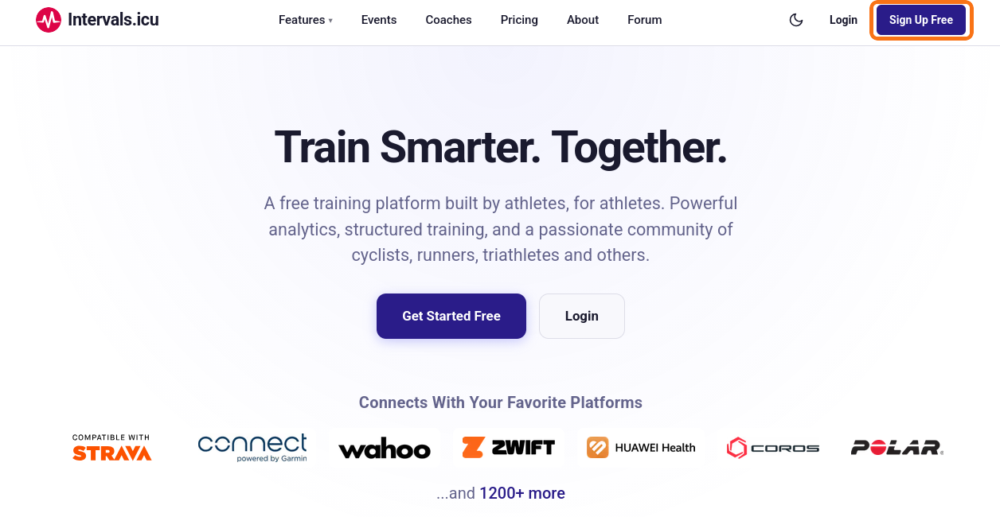
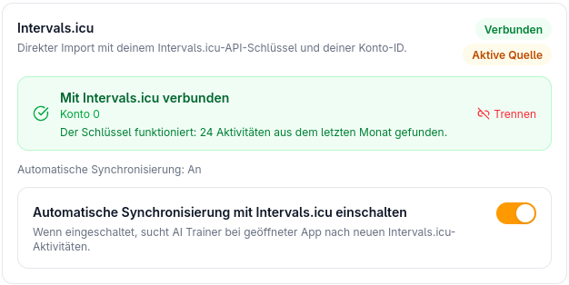

# Getting started

Your coach plans your training from your real rides. They come in through **intervals.icu**, a free training platform. Setting it up takes about ten minutes, and you do it once.

```
Device (Garmin, Wahoo …)  ──►  intervals.icu  ──►  Train Like a Pro
```

**First: Strava alone is not enough.** Strava forbids other services to pass its data on, so intervals.icu may not hand rides that come only from Strava to Train Like a Pro. In intervals.icu, connect the device or app you record with: Garmin, Wahoo, Zwift, COROS, Suunto, Polar or similar. You can keep using Strava as before.

**No device?** Train Like a Pro also takes FIT files by upload, and you can enter your sessions yourself.

The screenshots show the German interface of intervals.icu and of the app. The English names are given next to the German ones.

---

## 1. Create your account in the app

1. If you got an invitation link, open it. The code is already filled in.
2. Create your account with your email and a password. If the server asks you to confirm your address, a mail with a link arrives. Look in the spam folder too.

Onboarding asks about your rides later on. Have the intervals.icu account from step 2 ready by then, or set it up first.

## 2. Create an intervals.icu account

1. Go to <https://intervals.icu> and sign up with **Sign Up Free** at the top right. It is free.
2. If you already have an account, skip this step.



## 3. Connect your device to intervals.icu

1. In intervals.icu, open **Settings**: <https://intervals.icu/settings>. Choose the **Connections** tab at the top (German: *Verbindungen*).
2. Connect your device or app there, for example **Garmin Connect**, **Wahoo**, **Zwift**, **COROS**, **Suunto** or **Polar**.
3. Sign in to that service and allow the access.

A connected service has a tick at **Download activities**. From now on, every new ride lands in intervals.icu by itself.

If you ride on **Zwift**, connect Zwift itself: Zwift rides do not come in through Garmin or Wahoo.


**Older rides** that are only on Strava come in like this:

1. Ask Strava for your archive: *Settings → My Account → Download or Delete Your Account*. After a while, Strava mails you a download link.
2. In intervals.icu, open **Settings** → **Connections**. In the Strava box, click **Import All Strava Data** (German: *Alle Strava-Daten importieren*). You do not need to connect Strava for this.
3. Paste the download link from the mail into the dialog. The file cannot be uploaded, it is too large. If the link has expired, download the archive, put it in cloud storage (Google Drive, Dropbox, OneDrive) and paste its share link.

Rides imported this way do not count as Strava rides, so intervals.icu passes them on.


This is optional. The coach copes with a few rides and learns from every new one.

## 4. Copy your API key

1. In the intervals.icu settings, go to the first tab, **Settings**. Scroll all the way down to **Developer Settings** (German: *Entwicklereinstellungen*).
2. Under **API Key**, click **(view)**. A window with your key opens. If the field is empty, click **Generate**.
3. Copy the whole key, with no space before or after it. Do not click **Clear**: that deletes the key.


The key is like a password for your training data. Enter it only in the app, and send it to nobody.

## 5. Connect in the app

1. In onboarding, choose **intervals.icu**. Later you find the same in the app under **Settings → Activities → Data Sources**.
2. Paste the API key and press **Connect Intervals.icu**. You do not need the athlete ID: the key knows whose it is.
3. The app checks the key right away. If everything is right, you see something like: *"The key works: 12 activities found from the last month."*
4. Leave **Turn on automatic sync with Intervals.icu** on.



## 6. Tell your coach who you are

Open the chat with your coach and say what you are training for, how your typical week looks, and anything else your coach should know: an event date, an injury, the days you cannot ride. Every later session is built on that conversation.

---

## Something not working?

- **The app does not accept the key:** copy it again, completely and without spaces, from **Developer Settings**, and connect again.
- **The key works, but 0 rides are found:** your rides probably reach intervals.icu only through Strava so far. Connect your device as in step 3. New rides then come in by themselves.
- **Rides are in intervals.icu but not in the app:** check under **Settings → Activities** that **Turn on automatic sync with Intervals.icu** is on.
- **Anything else:** use **Report a problem** in the app's menu.

You can disconnect intervals.icu in the app's settings at any time.

---

## Optional: your own Google Gemini key

You do not need one: the coach runs without a key of your own. Add one only if you want to pay for your own AI usage, or if the server you use the app on has no shared key.

1. Go to [Google AI Studio](https://aistudio.google.com/apikey) and sign in with a Google account.
2. Click **Create API key** and pick a Google Cloud project, or let it create one.
3. Copy the key. It starts with `AIza…`.
4. In Train Like a Pro, open **Settings → Coach & AI → Your AI Provider Key**, paste the key and press **Test and save key**.

The key is stored encrypted.

---

*Deutsche Fassung: [erste-schritte.md](erste-schritte.md)*
