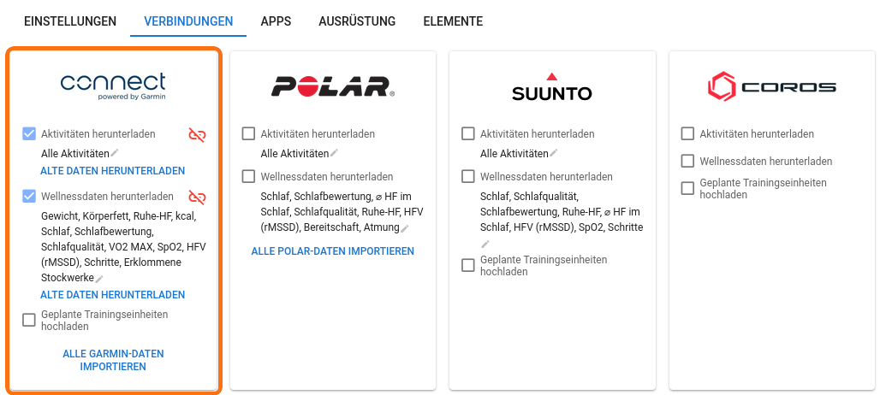
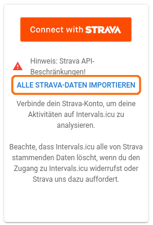
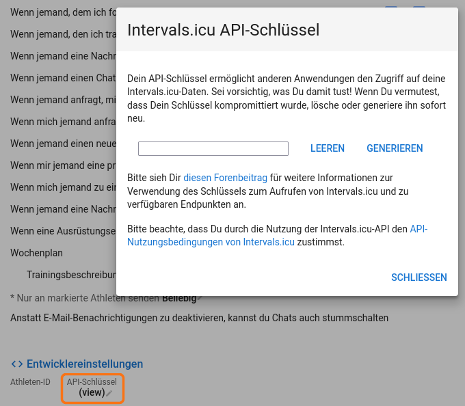

# Erste Schritte

Der Coach plant dein Training anhand deiner echten Fahrten. Die kommen über **intervals.icu**, eine kostenlose Trainingsplattform. Das Einrichten dauert etwa zehn Minuten, und du machst es nur einmal.

```
Gerät (Garmin, Wahoo …)  ──►  intervals.icu  ──►  Train Like a Pro
```

**Wichtig vorab: Strava allein reicht nicht.** Strava verbietet, dass andere Dienste Strava-Daten weitergeben. intervals.icu darf Fahrten, die nur über Strava kommen, deshalb nicht an Train Like a Pro weitergeben. Verbinde in intervals.icu also das Gerät oder die App, mit der du aufzeichnest: Garmin, Wahoo, Zwift, COROS, Suunto, Polar oder Ähnliches. Strava kannst du daneben ganz normal weiter benutzen.

**Kein Gerät?** Train Like a Pro nimmt auch FIT-Dateien per Upload, und du kannst deine Einheiten selbst eintragen.

---

## 1. Konto in der App anlegen

1. Hast du einen Einladungslink bekommen, öffne ihn. Der Code ist dort schon eingetragen.
2. Leg dein Konto mit E-Mail und Passwort an. Verlangt der Server eine Bestätigung, kommt eine Mail mit einem Link. Schau auch im Spam-Ordner nach.

Das Onboarding fragt später nach deinen Fahrten. Halte bis dahin das intervals.icu-Konto aus Schritt 2 bereit, oder richte es vorher ein.

## 2. intervals.icu-Konto anlegen

1. Geh auf <https://intervals.icu> und registriere dich, oben rechts über **Sign Up Free**. Das ist kostenlos.
2. Hast du schon ein Konto, kannst du diesen Schritt überspringen.


## 3. Dein Gerät mit intervals.icu verbinden

1. Öffne in intervals.icu die **Einstellungen** (*Settings*): <https://intervals.icu/settings>. Wähle dort oben den Reiter **Verbindungen**.
2. Verbinde dort dein Gerät oder deine App, zum Beispiel **Garmin Connect**, **Wahoo**, **Zwift**, **COROS**, **Suunto** oder **Polar**.
3. Melde dich beim jeweiligen Dienst an und erlaube den Zugriff.

Ein verbundener Dienst hat einen Haken bei **Aktivitäten herunterladen**. Ab jetzt landet jede neue Fahrt automatisch in intervals.icu.

Fährst du mit **Zwift**, verbinde Zwift selbst: Über Garmin oder Wahoo kommen Zwift-Fahrten nicht an.



**Ältere Fahrten**, die bisher nur auf Strava liegen, holst du so:

1. Fordere bei Strava dein Archiv an: *Einstellungen → Mein Konto → Konto herunterladen oder löschen*. Nach einer Weile schickt Strava dir eine Mail mit einem Download-Link.
2. Öffne in intervals.icu die **Einstellungen** → **Verbindungen**. Klicke im Strava-Kasten auf **Alle Strava-Daten importieren** (englisch *Import All Strava Data*). Strava musst du dafür nicht verbinden.
3. Füge im Dialog den Download-Link aus der Mail ein. Hochladen lässt sich die Datei nicht, sie ist zu groß. Ist der Link abgelaufen, lade das Archiv herunter, leg es in einen Cloud-Speicher (Google Drive, Dropbox, OneDrive) und füge dessen Freigabe-Link ein.

So importierte Fahrten zählen nicht als Strava-Fahrten, intervals.icu gibt sie also weiter.



Das ist freiwillig. Der Coach kommt auch mit wenigen Fahrten zurecht und lernt mit jeder neuen dazu.

## 4. API-Schlüssel kopieren

1. Geh in den intervals.icu-Einstellungen auf den ersten Reiter, **Einstellungen**. Scroll ganz nach unten bis **Entwicklereinstellungen** (*Developer Settings*).
2. Klicke unter **API-Schlüssel** auf **(view)**. Ein Fenster mit deinem Schlüssel geht auf. Ist das Feld leer, klicke auf **Generieren**.
3. Kopiere den ganzen Schlüssel, ohne Leerzeichen davor oder danach. Klicke nicht auf **Leeren**: Das löscht den Schlüssel.



Der Schlüssel ist wie ein Passwort für deine Trainingsdaten. Gib ihn nur in der App ein und schick ihn niemandem.

## 5. In der App verbinden

1. Wähl im Onboarding **intervals.icu verbinden**. Später findest du dasselbe in der App unter **Einstellungen → Aktivitäten → Datenquellen**.
2. Füge den API-Schlüssel ein und tippe auf **Intervals.icu verbinden**. Die Konto-ID brauchst du nicht, der Schlüssel weiß, wem er gehört.
3. Die App prüft den Schlüssel sofort. Stimmt alles, siehst du zum Beispiel: *„Der Schlüssel funktioniert: 12 Aktivitäten aus dem letzten Monat gefunden.“*
4. Lass **Automatische Synchronisierung mit Intervals.icu einschalten** an.


## 6. Erzähl deinem Coach, wer du bist

Öffne den Chat mit deinem Coach und erzähl, worauf du hintrainierst, wie deine typische Woche aussieht und was dein Coach sonst wissen sollte: ein Termin, eine Verletzung, die Tage, an denen du nicht fahren kannst. Auf diesem Gespräch baut jede spätere Einheit auf.

## Jeden Tag

- **Fahren.** Deine Fahrt kommt über dein Gerät zu intervals.icu. Die App schaut alle 30 Minuten nach. Die Fahrt steht dann unter **Mehr: letzte Aktivitäten und Vorhersagen**, und dein Coach kennt sie.
- **Der Plan.** Er reicht 14 Tage voraus und rückt jede Nacht weiter. Was du gefahren bist und was du deinem Coach geantwortet hast, nimmt er über Nacht auf.
- **Etwas ändern.** Ändere Trainingstage, Stunden oder dein Rennen in den Einstellungen oder sag es deinem Coach im Chat. Der Plan wird dann gleich neu gebaut. Solange das läuft, steht es oben auf der Startseite. Sind die Neubauten für heute aufgebraucht, übernimmt der Plan deine Änderung in der Nacht.
- **Dem Coach antworten.** Hat dein Coach eine Frage, steht sie oben im Chat. Tipp eine Antwort an oder schreib sie. Fahrten, zu denen er etwas wissen muss, stehen unter **Braucht deine Antwort**.
- **Wie waren die Beine?** Unter jeder Fahrt kannst du bei **Beine** antippen, wie frisch oder schwer sie sich angefühlt haben. Das ist die schnellste Rückmeldung, die du geben kannst.
- **Etwas stimmt nicht.** Unter einer Antwort des Coaches oder bei einer Einheit kannst du **Das stimmt nicht** antippen und kurz schreiben, was falsch ist. Das liest der Betreiber. Damit dein Coach es ändert, tipp danach auf **Auch deinem Coach sagen**: Deine Notiz geht dann auch an ihn.

---

## Wenn etwas hakt

- **Die App nimmt den Schlüssel nicht an:** Kopiere ihn noch einmal vollständig aus den **Entwicklereinstellungen**, ohne Leerzeichen, und verbinde neu.
- **Der Schlüssel funktioniert, aber es werden 0 Fahrten gefunden:** Wahrscheinlich kommen deine Fahrten bisher nur über Strava. Verbinde dein Gerät wie in Schritt 3. Neue Fahrten kommen dann von selbst.
- **Fahrten sind in intervals.icu, aber nicht in der App:** Prüf unter **Einstellungen → Aktivitäten**, ob **Automatische Synchronisierung mit Intervals.icu einschalten** an ist.
- **Etwas anderes:** Nutze im Menü der App **Problem melden**.

Die Verbindung kannst du jederzeit in den Einstellungen der App trennen.

---

## Optional: eigener Google-Gemini-Key

Den brauchst du nicht: Der Coach läuft ohne eigenen Schlüssel. Hinterleg einen nur, wenn du deine KI-Nutzung selbst bezahlen willst, oder wenn der Server, auf dem du die App nutzt, keinen gemeinsamen Schlüssel hat.

1. Geh zu [Google AI Studio](https://aistudio.google.com/apikey) und melde dich mit einem Google-Konto an.
2. Klick auf **Create API key** und wähl ein Google-Cloud-Projekt, oder lass eins anlegen.
3. Kopier den Key. Er beginnt mit `AIza…`.
4. Öffne in Train Like a Pro **Einstellungen → Coach & KI → Dein KI-Schlüssel**, füg den Key ein und klick auf **Schlüssel testen und speichern**.

Der Key wird verschlüsselt gespeichert.

---

*English version: [Getting started](/guide)*
